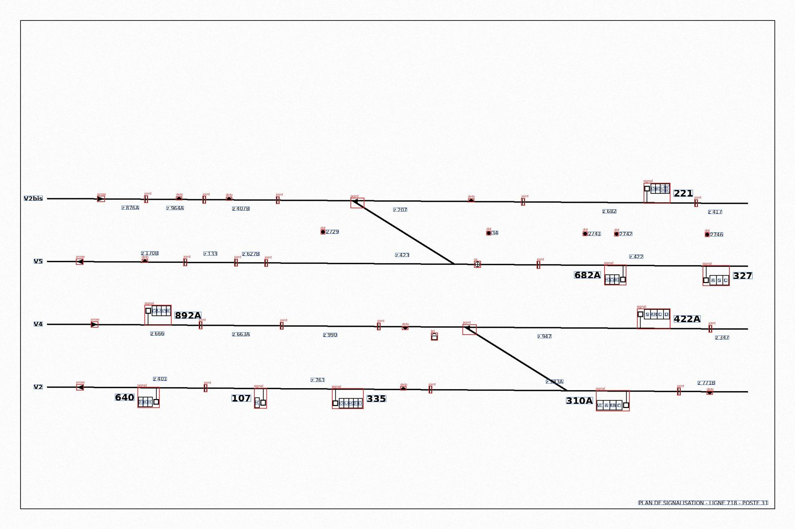
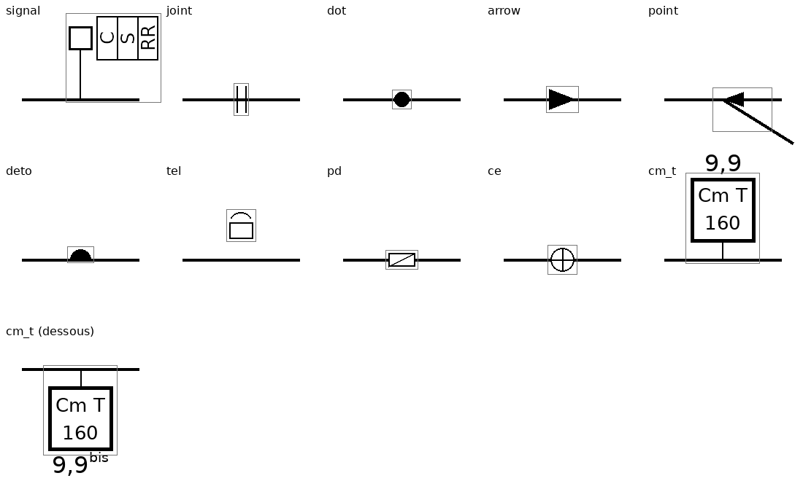

# rail-diagram-reader

Lecture automatique de **schémas de signalisation ferroviaire** : à partir d'un plan
(PDF ou image), retrouver chaque signal, son nom, sa voie et son point kilométrique.

Projet personnel, écrit de zéro avec des briques open source. Aucune donnée réelle
n'est versionnée : l'entraînement et l'évaluation reposent sur des **plans synthétiques**
générés par ce dépôt.

## Architecture visée

```
PDF / image ──► tuilage ──► détection de symboles (RT-DETR, Ultralytics)
                               │
                               ├──► OCR des textes (PaddleOCR / docTR)
                               │
                               └──► association symbole ↔ nom ↔ voie ↔ PK
                                        (règles géométriques, puis VLM)
                                                  │
                                                  ▼
                                      tableau des signaux (nom, type, voie, PK)
```

| Étape | État | Module |
|---|---|---|
| Synthèse de données annotées | ✅ v0.2 | `diagram_reader.synth` |
| Extraction des voies (graphe) | ✅ v0.1 | `diagram_reader.tracks` |
| Tuilage / recombinaison | à faire | `diagram_reader.tiling` |
| Détection de symboles | à faire | `diagram_reader.detect` |
| OCR | à faire | `diagram_reader.ocr` |
| Association et calcul du PK | à faire | `diagram_reader.associate` |
| Évaluation bout en bout | à faire | `diagram_reader.eval` |

## Classes détectées

| id | nom | description |
|---|---|---|
| 0 | `arrow` | flèche de sens de circulation |
| 1 | `dot` | repère kilométrique / hectométrique numéroté |
| 2 | `point` | aiguille (pointe + talon) |
| 3 | `signal` | panneau : mât, pied, cartouche d'indications |
| 4 | `deto` | pétard |
| 5 | `tel` | téléphone de voie |
| 6 | `pd` | pédale de détection |
| 7 | `ce` | compteur d'essieux |
| 8 | `joint` | joint isolant (limite de zone) |
| 9 | `cm` | commutateur de limitation de vitesse (Cm T 160) |

## Installation

```bash
python -m venv .venv && source .venv/bin/activate   # Windows : .venv\Scripts\activate
pip install -e ".[dev]"
```

Extras : `.[train]` (Ultralytics) et `.[ocr]` (PaddleOCR) quand ces étapes existeront.

## Synthétiseur

```bash
rdr-synth --out data/synth -n 200 --seed 0 --preview
```

Produit une arborescence directement consommable par Ultralytics :

```
data/synth/
  data.yaml
  images/{train,val}/plan_000000.png
  labels/{train,val}/plan_000000.txt   # YOLO : id cx cy w h (normalisés)
  meta/plan_000000.json                # vérité terrain complète (voir ci-dessous)
  preview/plan_000000.jpg              # --preview : boîtes dessinées pour contrôle
```

Chaque `meta/*.json` contient, au-delà des boîtes :

- `texts` : tous les textes écrits avec leur boîte et leur rôle
  (`signal_name`, `indication`, `pk`, `zone`, `track_name`, `title`) → évaluation OCR ;
- `signals` : pour chaque signal, `name`, `track`, `pk_m`, `indications`, `direction`,
  et les boîtes du symbole et de son nom → évaluation de l'**association** ;
- `tracks` : nom, ordonnées aux extrémités, sens.

Ce que le générateur fait varier : nombre de voies (2–4), pente, échelle des symboles,
épaisseur des traits, nombre et position des zones/signaux/équipements, texte des
cartouches horizontal ou vertical, fond et bruit « scan ».

Aperçu (`--preview`, boîtes rouges = symboles, bleues = textes) :



## Bibliothèque de symboles

Les symboles ajoutés depuis les relevés de plans réels sont décrits de façon
**déclarative** dans `synth/library.py` : primitives (rectangle, ligne, cercle,
polygone, texte) dans un repère local dont l'origine est le point d'attache sur la
voie, avec des textes fixes et des *slots* de texte variable (le nom du commutateur,
par exemple), chacun portant un rôle d'annotation.

```bash
python -m diagram_reader.synth.sheet      --out docs/symbols.png   # planche de contrôle
python -m diagram_reader.synth.dxf_export --out docs/symbols.dxf   # export CAO (ezdxf)
```



Pour ajouter un symbole : une entrée `VectorSymbol` dans `library.py`, une ligne dans
`classes.py` si c'est une nouvelle classe, et son placement dans `generator.py`.

## Voies

Les voies ne sont pas des objets à boîte englobante : ce sont des traits épais qui se
divisent et fusionnent. `diagram_reader.tracks` en extrait un **graphe** (nœuds =
extrémités et aiguilles, arêtes = segments de voie) à partir d'une image :

1. binarisation (seuil adaptatif, scans inégaux) ;
2. masque des traits épais : les voies sont les seuls traits larges qui *traversent* le
   plan ; le seuil d'épaisseur est trouvé automatiquement sur ce critère ;
3. squelette → graphe (via `skan`), élagage des barbules et petites boucles laissées par
   les symboles collés à la voie, fusion des nœuds proches, suppression des composantes
   trop courtes, pontage des coupures laissées par les cartouches posés sur la voie.

Tous les seuils sont exprimés en **millimètres papier** et convertis en pixels via
l'épaisseur mesurée des voies : le résultat ne dépend ni de la résolution du scan ni du
format (feuille ou rouleau).

```python
import cv2
from diagram_reader.tracks import extract_tracks
img = cv2.imread("plan.png", cv2.IMREAD_GRAYSCALE)
res = extract_tracks(img)
res.graph.to_json()           # nœuds, arêtes (polylignes), longueurs
cv2.imwrite("overlay.png", res.graph.draw(img))
```

### Vérité terrain et mesure

Quand on dispose du DXF d'un plan, les voies y sont des polylignes à largeur constante :
`tools/dxf_truth.py` rasterise le plan à un DPI de scan réaliste et produit le masque
vrai des voies ; `python -m diagram_reader.tracks.eval` mesure précision/rappel du
squelette et rappel des aiguilles. Les DXF et les rendus restent dans `data/`, hors git.

## Principes

- **Pas de données réelles dans le dépôt** (`data/`, poids et checkpoints sont ignorés par git).
- Aucun symbole n'est dessiné sans être annoté : le générateur vérifie l'emprise avant de tracer.
- Chaque étage se mesure séparément contre la vérité terrain synthétique, avant toute
  évaluation sur des plans réels.

## Feuille de route

1. Tuilage des grandes images (patchs avec recouvrement, fusion des détections par NMS).
2. Entraînement RT-DETR sur synthétique, courbes F1/seuil par classe.
3. OCR sur les zones de texte ; comparaison PaddleOCR vs docTR sur `texts`.
4. Association par règles (plus proche nom dans le sens de circulation, projection
   sur la voie, interpolation du PK entre repères) et métriques sur `signals`.
5. Remplacement partiel de l'association par un VLM, comparaison.

## Licence

MIT.
